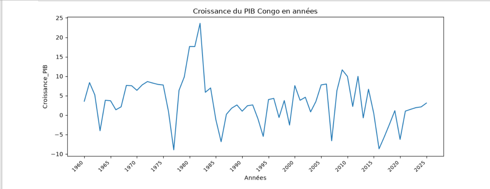
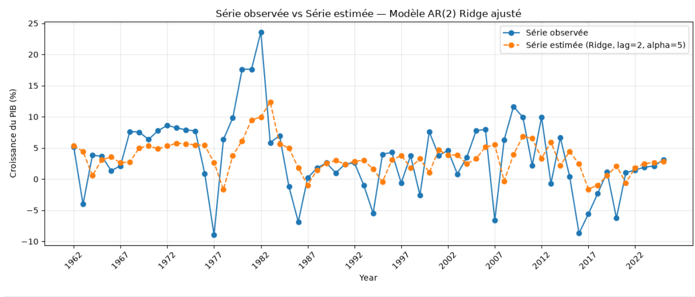

# 🤖📊📈 Prévision de la croissance du PIB réel — République du Congo

Ce dépôt présente une démarche complète de **Machine Learning appliqué aux séries temporelles** pour analyser, valider et projeter la **croissance annuelle du PIB réel de la République du Congo (`COG`)** jusqu'en **2030**.

Le projet combine une approche univariée autorégressive (`AR(2)`) et une phase d'évaluation multivariée (`ARX` avec indicateurs macroéconomiques retardés), validées de manière chronologique via `TimeSeriesSplit`. Les expériences montrent qu'un modèle parcimonieux `AR(2)` régularisé (`StandardScaler` + `Ridge(alpha=5.0)`) offre la meilleure généralisation hors échantillon (`MAE = 4.740`, `RMSE = 5.778`), surclassant les modèles à 3 retards, les approches non linéaires (`RandomForest`) ainsi que les extensions multivariées testées.

---

## 1. Structure du dépôt

```text
PROJET_ML_CROISSANCE_PIB-ANNUEL-_CONGO/
├── notebook_and_script/                          # Notebook et scripts du projet
│   └── ML_PIB_COG.ipynb                          # Notebook principal (extraction, nettoyage, ADF, AR(2), ARX, prévision 2030)
├── modele_ar_pib_congo_v1.joblib                 # Modèle figé et sauvegardé (Ridge, lag=2, alpha=5.0)
├── dataset/                                      # Données principales et extraites
│   ├── API_NY.GDP.MKTP.KD.ZG_DS2_fr_csv_v2_122.csv # Jeu de données initial complet (Banque mondiale)
│   └── data_cog.csv                              # Données extraites pour la République du Congo
├── assets/                                       # Graphiques PNG intégrés au README
│   ├── stationnarite_visuelle_pib_cog.png        # Visualisation initiale avant modélisation (stationnarité visuelle)
│   ├── serie_observee_vs_estimee_v0.png          # Série observée vs série estimée (premier modèle avec 3 lags)
│   ├── serie_observee_vs_estimee_ar2_ridge.png   # Série observée vs série estimée (modèle AR(2) Ridge ajusté)
│   └── comparaison_ar2_vs_modele2_2030.png       # Superposition AR(2) vs Modèle 2 multivarié & projection 2026–2030
└── README.md                                     # Documentation complète du projet
```

---

## 2. Chargement, extraction, nettoyage et stationnarité

### Source et variable cible

- **Source :** World Development Indicators (Banque mondiale) — croissance annuelle du PIB réel (`NY.GDP.MKTP.KD.ZG`) et indicateurs macroéconomiques complémentaires (`Exports`, `Imports`, `FBCF`, `Conso_Publique_Pct_PIB`, `Compte_Courant_Pct_PIB`, `Inflation_IPC`).
- **Pays ciblé :** République du Congo (`COG`), sur 66 observations annuelles (`1960`–`2025`).

### Étapes de préparation

1. **Chargement du dataset principal :** importation du fichier CSV principal dans un `DataFrame` `pandas` (`dataset/API_NY.GDP.MKTP.KD.ZG_DS2_fr_csv_v2_122.csv`) et vérification de la structure des colonnes et des pays présents.
2. **Extraction du sous-ensemble Congo (`data_cog`) :** filtrage sur la République du Congo pour isoler la chronologie d'intérêt et sauvegarde dans `dataset/data_cog.csv`.
3. **Tri chronologique (`Year`) et prévention des fuites de données :** ordonnancement strict par année croissante (`Year`) avant la création des retards (*lags*) et encapsulation systématique de l'imputation (`SimpleImputer`) et de la standardisation (`StandardScaler`) à l'intérieur des `Pipeline` `scikit-learn`.

### Vérification de la stationnarité (visuelle + test ADF)



- **Observation :** la croissance annuelle du PIB de la République du Congo oscille autour d'une moyenne historique d'environ `3.5 %` avec des phases d'expansion et de contraction marquées, sans dérive tendancielle continue.
- **Test statistique ADF :** le test **ADF (Augmented Dickey-Fuller)** rejette l'hypothèse de racine unitaire (`p-value = 0.000`), confirmant la stationnarité de la série et permettant de modéliser directement `Croissance_PIB` sans différenciation supplémentaire.

---

## 3. Modèle exploratoire initial à trois retards (`MAX_LAG = 3`)

Une première phase de modélisation a évalué un modèle autorégressif à **trois retards (`lag_1`, `lag_2`, `lag_3`)** sur **63 observations (`1963`–`2025`)** via `TimeSeriesSplit` (`n_splits=5`) :

- **Ridge :** `MAE = 5.115` | `RMSE = 6.234`
- **ElasticNet :** `MAE = 5.204` | `RMSE = 6.228`
- **RandomForest :** `MAE = 5.617` | `RMSE = 6.634`


- **Enseignement :** `Ridge` surpasse `ElasticNet` et `RandomForest` sur le `MAE`, mais l'inclusion du troisième retard (`lag_3`) introduit de l'inertie supplémentaire sans gain de précision hors échantillon.

---

## 4. Optimisation univariée et sélection du modèle `AR(2)` `Ridge`

### Grille d'ajustement (`MAX_LAG` et `alpha`)

Une grille d'hyperparamètres sur `MAX_LAG` (`1` à `4`) et `alpha` (`1.0` à `50.0`) évaluée via `TimeSeriesSplit` (`n=64`) a permis d'identifier la configuration optimale :

| Rang | `MAX_LAG` | `alpha` | Erreur absolue moyenne (MAE) | Racine de l'erreur quadratique moyenne (RMSE) | Observation |
| :---: | :---: | :---: | :---: | :---: | :--- |
| 1 | **2** | **5.0** | **4.740** | **5.778** | **Configuration optimale retenue (`lag_optimal = 2`, `alpha = 5.0`)** |
| 2 | 2 | 10.0 | 4.742 | 5.820 | Très proche, régularisation légèrement plus marquée |
| 3 | 1 | 1.0 | 4.760 | 5.772 | Modèle `AR(1)` sobre, `RMSE` légèrement inférieur |
| 4 | 2 | 1.0 | 4.775 | 5.753 | Moins de lissage sur les erreurs quadratiques |

Passer de `MAX_LAG = 3` à **`MAX_LAG = 2`** avec **`alpha = 5.0`** réduit le `MAE` de `5.115` à **`4.740`** et le `RMSE` de `6.234` à **`5.778`**.

### Comparaison d'algorithmes sur la base `AR(2)` (`n=64`)

| Modèle | `n_obs` | `MAE_moyen` | `RMSE_moyen` |
| :--- | :---: | :---: | :---: |
| **Ridge (`alpha=5.0`) [Modèle retenu]** | **64** | **4.740** | **5.778** |
| Ridge (`alpha=15.0`) | 64 | 4.752 | 5.862 |
| Ridge (`alpha=1.0`) | 64 | 4.775 | 5.753 |
| Lasso (`alpha=0.5`) | 64 | 4.783 | 5.816 |
| ElasticNet (`alpha=0.5, l1=0.5`) | 64 | 4.784 | 5.816 |
| RandomForest (`depth=3, n=200`) | 64 | 5.305 | 6.378 |

---

## 5. Évaluation multivariée (`Modèle 2` / `ARX`) et contrôle de robustesse

Afin de vérifier si l'intégration de déterminants macroéconomiques améliore la prévision, plusieurs variables exogènes retardées d'un an (`lag1`, pour éviter toute fuite de données) ont été testées : `Conso_Publique_Pct_PIB_lag1`, `Exports_lag1`, `Imports_lag1` et `FBCF_lag1`.

### A. Modèle multivarié complet (`AR(2)` + 4 exogènes `lag1`)

- **Modèle 2 — ElasticNet :** `MAE_moyen = 5.832` | `RMSE_moyen = 7.222`
- **Modèle 2 — RandomForest :** `MAE_moyen = 5.889` | `RMSE_moyen = 6.962`
- **Modèle 2 — Ridge (`alpha=5.0`) :** `MAE_moyen = 6.149` | `RMSE_moyen = 7.578`

L'ajout simultané des variables exogènes en niveau retardé dégrade fortement la généralisation (`MAE` passant de `4.740` à `5.832–6.149`) en raison de la forte variance et de la taille limitée de l'échantillon annuel.

### B. Étude d'ablation et contrôle à périmètre strictement égal (`n=51`)

| Modèle testé | Périmètre (`n_obs`) | `MAE_moyen` | `RMSE_moyen` | Conclusion |
| :--- | :---: | :---: | :---: | :--- |
| **Baseline `AR(2)` — même échantillon** | **51** | **4.222** | **5.137** | **Meilleure généralisation à période identique** |
| `AR(2)` + `FBCF_lag1` | 51 | 4.562 | 5.642 | Dégrade le score par rapport au baseline sur `n=51` |
| `AR(2)` + `Exports_lag1` | 64 | 4.895 | 5.988 | Ajoute du bruit par rapport au baseline (`4.740`) |
| `AR(2)` + `Imports_lag1` | 64 | 4.977 | 6.228 | Dégrade le `MAE` et le `RMSE` |
| `AR(2)` + `Conso_Publique_Pct_PIB_lag1` | 64 | 5.546 | 6.821 | Forte dégradation hors échantillon |

> **Pourquoi le modèle `AR(2)` `Ridge(alpha=5.0)` est définitivement retenu :** ce choix repose sur une sélection empirique rigoureuse. À échantillon identique (`n=51` comme `n=64`), le modèle `AR(2)` bat systématiquement les extensions multivariées en validation temporelle tout en exploitant l'intégralité de l'historique disponible depuis 1962.

---

## 6. Prévision récursive (2026–2030) et visualisations finales

Le pipeline final (`StandardScaler` + `Ridge(alpha=5.0)`) est entraîné sur l'historique complet disponible et sauvegardé dans **`modele_ar_pib_congo_v1.joblib`**. À partir de la croissance observée en 2025 (**`3.083 %`**), la prévision récursive réinjecte chaque estimation annuelle comme prochain retard (`lag_1`, `lag_2`) :

| `Year` | `lag_1` utilisé (%) | `lag_2` utilisé (%) | `Croissance_PIB_Predite` (%) | Nature de la projection |
| :---: | :---: | :---: | :---: | :--- |
| **2026** | 3.083 | 2.100 | **3.190** | Prévision récursive (`t+1`) |
| **2027** | 3.190 | 3.083 | **3.295** | Prévision récursive (`t+2`) |
| **2028** | 3.295 | 3.190 | **3.344** | Prévision récursive (`t+3`) |
| **2029** | 3.344 | 3.295 | **3.370** | Prévision récursive (`t+4`) |
| **2030** | 3.370 | 3.344 | **3.383** | Prévision récursive (`t+5`) |



*(Optionnel : enregistrer la superposition comparative `AR(2)` vs `Modèle 2` et prévision `2026–2030` dans `assets/comparaison_ar2_vs_modele2_2030.png`.)*

---

## 7. Interprétation, limites et pistes d'évolution

- **Interprétation de la trajectoire 2026–2030 :** la projection récursive dessine une stabilisation progressive entre **`3.19 %` (2026)** et **`3.38 %` (2030)**, convergeant naturellement vers le régime moyen historique de l'économie congolaise (`~3.5 %`).
- **Limites assumées :** en tant que modèle autorégressif régularisé entraîné sur données annuelles (`MAE` moyen de `4.74` points en validation croisée), `AR(2)` fournit un **scénario central inertiel** fiable, mais ne peut anticiper seul des chocs exogènes majeurs (fluctuations brutales du cours du pétrole, chocs budgétaires ou crises externes).
- **Pistes futures :** intégrer des indicateurs sectoriels à plus haute fréquence (prix du baril Brent, production pétrolière en volume) ou tester des transformations stationnaires différenciées (`diff(1)`) couplées à des scénarios macroéconomiques (prudent, central, optimiste).
