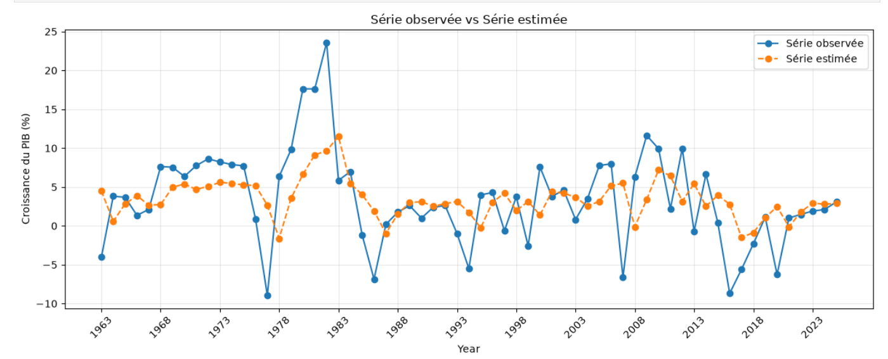

# 🤖📊📈 Prévision de la croissance du PIB réel — République du Congo

Ce dépôt présente une démarche complète de **Machine Learning appliqué aux séries temporelles** pour analyser, valider et projeter la **croissance annuelle du PIB réel de la République du Congo** jusqu'en **2030**.

Le projet repose sur un modèle autorégressif (`AR(2)`) avec régression `Ridge` (`StandardScaler` + `Ridge`), une validation chronologique via `TimeSeriesSplit`, l'ajustement des hyperparamètres (`MAX_LAG = 2`, `alpha = 5.0`), la prévision récursive jusqu'en **2030** et la sauvegarde du modèle (`modele_ar_pib_congo_v1.joblib`).

## 1. Structure du dépôt

```text
prevision-pib-congo-ml/
├── notebook_and_script/                          # Notebook et scripts du projet
│   └── ML_PIB_COG.ipynb                          # Notebook principal (extraction, nettoyage, ADF, lags, ML, prévision 2030)
├── modele_ar_pib_congo_v1.joblib                 # Modèle figé et sauvegardé (Ridge, lag=2, alpha=5.0)
├── dataset/                                      # Données principales et extraites
│   ├── API_NY.GDP.MKTP.KD.ZG_DS2_fr_csv_v2_122.csv # Jeu de données initial complet (Banque mondiale)
│   └── data_cog.csv                              # Données extraites pour la République du Congo
├── assets/                                       # Graphiques PNG intégrés au README
│   ├── stationnarite_visuelle_pib_cog.png        # Visualisation initiale avant modélisation (stationnarité visuelle)
│   ├── serie_observee_vs_estimee_v0.png          # Série observée vs série estimée (premier modèle avec 3 lags)
│   └── serie_observee_vs_estimee_ar2_ridge.png   # Série observée vs série estimée (modèle AR(2) Ridge ajusté)
└── README.md                                     # Documentation complète du projet
```

## 2. Chargement, extraction, nettoyage et stationnarité

### Source et variable cible

* **Source :** indicateur macroéconomique de croissance annuelle du PIB réel (`NY.GDP.MKTP.KD.ZG`, World Development Indicators / Banque mondiale).
* **Pays ciblé :** République du Congo (`COG`).

### Étapes de chargement et d'extraction

1. **Chargement du dataset principal :** importation du fichier CSV principal dans un `DataFrame` `pandas` (`dataset/API_NY.GDP.MKTP.KD.ZG_DS2_fr_csv_v2_122.csv`) et vérification de la structure des colonnes et des pays présents.
2. **Extraction du sous-ensemble Congo (`data_cog`) :** filtrage sur la République du Congo pour isoler la chronologie d'intérêt, puis enregistrement de l'extrait dédié (`data_cog.csv` dans `dataset/`) afin de disposer d'une base claire pour la modélisation.
3. **Tri chronologique (`Year`) :** ordonnancement strict des observations par année croissante (`Year`) afin de garantir l'ordre temporel avant la génération des variables retardées (*lags*).

### Nettoyage et vérification de la stationnarité (visuelle + test ADF, sans KPSS)

* **Traitement des valeurs manquantes :** prise en charge des valeurs manquantes (notamment l'imputation par la moyenne de l'observation manquante en `1960` lors du prétraitement initial).
* **Appréciation visuelle de la stationnarité :** dès le tracé initial de la série de croissance du PIB congolais, la courbe paraît déjà stationnaire : elle oscille autour d'un niveau moyen sans tendance divergente sur l'ensemble de la période, malgré des chocs ponctuels marqués.

### Visualisation initiale — Stationnarité visuelle de la croissance du PIB (Congo)


* **Observation :** la croissance annuelle du PIB de la République du Congo paraît déjà stationnaire visuellement : elle oscille autour d'un niveau moyen avec des phases d'expansion et de contraction, sans dérive continue.
* **Test statistique ADF :** pour confirmer formellement cette appréciation visuelle, seul le test **ADF (Augmented Dickey-Fuller)** a été réalisé. Le test ADF rejette la racine unitaire (`p-value = 0.000`), confirmant la stationnarité de la série et permettant de modéliser directement `Croissance_PIB` sans différenciation supplémentaire.

## 3. Premier modèle initial avec trois retards (`MAX_LAG = 3`)

Une fois la stationnarité confirmée par le test ADF, une première phase de modélisation exploratoire a été menée en construisant un modèle autorégressif à **trois retards (`MAX_LAG = 3`)** :

1. **Création des trois variables retardées (`lag_1`, `lag_2`, `lag_3`) :** transformation de la série stationnaire en problème d'apprentissage supervisé en utilisant les trois années précédentes (`lag_1`, `lag_2` et `lag_3`) pour prédire `Croissance_PIB` à l'année $t$. Après suppression des trois premières lignes incomplètes (`1960`–`1962`), le jeu de données prêt pour le Machine Learning compte **63 observations (années `1963` à `2025`)**.
2. **Validation croisée temporelle (`TimeSeriesSplit`, `n_splits=5`) et comparaison des modèles :** évaluation stricte dans l'ordre chronologique (sans fuite de données) de trois algorithmes candidats (`Ridge`, `ElasticNet` et `RandomForest`) :

   * **Ridge :**
     * **Erreur absolue moyenne (MAE) :** `5.115`
     * **Racine de l'erreur quadratique moyenne (RMSE) :** `6.234`
   * **ElasticNet :**
     * **Erreur absolue moyenne (MAE) :** `5.204`
     * **Racine de l'erreur quadratique moyenne (RMSE) :** `6.228`
   * **RandomForest :**
     * **Erreur absolue moyenne (MAE) :** `5.617`
     * **Racine de l'erreur quadratique moyenne (RMSE) :** `6.634`

3. **Sélection de l'algorithme `Ridge` :** sur cette configuration initiale à **3 lags**, la régression **`Ridge`** obtient la plus faible **Erreur absolue moyenne (MAE)** (`5.115`) tout en restant très proche d'`ElasticNet` sur la **Racine de l'erreur quadratique moyenne (RMSE)** (`6.234` contre `6.228`), ce qui motive son choix pour la suite de l'optimisation.
4. **Diagnostic visuel du premier modèle (`MAX_LAG = 3`) :** tracé de la série observée face à la série estimée afin d'analyser le comportement concret des prédictions.

### Série observée vs Série estimée — Premier modèle initial (`3 lags`)



* **Observation :** la série estimée suit le mouvement moyen de la série observée mais reste nettement plus lissée lors des variations rapides.
* **Interprétation :** la courbe estimée suit la tendance moyenne de la croissance du PIB mais reste fortement aplatie face aux variations brusques. La pénalisation `Ridge` privilégie la stabilité en réduisant la variance, ce qui lisse les pics élevés (au-delà de 15 %–20 %) et les chutes sévères (sous -5 %). De plus, l'inclusion du troisième retard (`lag_3`) ajoute de l'inertie sans améliorer la précision, ce qui justifie l'étape suivante d'optimisation conjointe du nombre de retards (`MAX_LAG`) et du paramètre de régularisation (`alpha`).

## 4. Ajustement et modèle retenu : Modèle Autorégressif `AR(2)` avec `Ridge`

### Grille d'ajustement (`MAX_LAG` et `alpha`)

À partir des enseignements du premier modèle à 3 lags, une grille d'ajustement sur `MAX_LAG` (`1` à `4`) et `alpha` (`1.0` à `50.0`) évaluée via `TimeSeriesSplit` a permis d'affiner les performances :

| Rang | `MAX_LAG` | `alpha` | Erreur absolue moyenne (MAE) | Racine de l'erreur quadratique moyenne (RMSE) | Observation |
| :---: | :---: | :---: | :---: | :---: | :--- |
| 1 | **2** | **5.0** | **4.740** | **5.778** | **Configuration retenue (`lag_optimal = 2`, `alpha_optimal = 5.0`)** |
| 2 | 2 | 10.0 | 4.742 | 5.820 | Très proche, régularisation légèrement plus marquée |
| 3 | 1 | 1.0 | 4.760 | 5.772 | Modèle `AR(1)` sobre, `RMSE` très légèrement inférieur |
| 4 | 2 | 1.0 | 4.775 | 5.753 | Moins de lissage sur les erreurs quadratiques |

Passer de **`MAX_LAG = 3`** à **`MAX_LAG = 2`** avec **`alpha = 5.0`** réduit l'**Erreur absolue moyenne (MAE)** de `5.115` à **`4.740`** et la **Racine de l'erreur quadratique moyenne (RMSE)** de `6.234` à **`5.778`**. Les deux premiers retards annuels (`lag_1`, `lag_2`) concentrent l'information utile à court terme, tandis que la suppression de `lag_3` élimine du bruit inutile.

### Entraînement final, prévision jusqu'en 2030 et sauvegarde

* Le pipeline final (`StandardScaler` + `Ridge(alpha=5.0)`) est entraîné sur l'ensemble de l'historique disponible et enregistré dans **`modele_ar_pib_congo_v1.joblib`**.
* La **prévision récursive jusqu'en 2030** réinjecte chaque prévision annuelle comme prochain retard (`lag_1`, `lag_2`), produisant une trajectoire tendancielle douce et convergente (démarrant autour de **3.19 %** et se stabilisant progressivement vers **~3.38 %** en **2030**).
#### Projections annuelles de la croissance du PIB réel (2026–2030)

| `Year` | `Croissance_PIB_Predite` (%) | Nature de la projection |
| :---: | :---: | :--- |
| **2026** | **3.190** | Prévision récursive (`t+1`) |
| **2027** | **3.295** | Prévision récursive (`t+2`) |
| **2028** | **3.344** | Prévision récursive (`t+3`) |
| **2029** | **3.370** | Prévision récursive (`t+4`) |
| **2030** | **3.383** | Prévision récursive (`t+5`) |

## 5. Visualisation finale — Modèle `AR(2)` `Ridge` ajusté (`lag=2`, `alpha=5`)


* **Observation :** l'axe `Year` est gradué proprement de `1962` à la fin de l'historique, et la courbe orange (`Ridge, lag=2, alpha=5`) épouse plus souplement les évolutions récentes tout en restant plus douce que les chocs extrêmes.
* **Interprétation globale :** parce qu'il s'appuie uniquement sur le passé de la variable cible (`lag_1`, `lag_2`), le modèle `AR(2)` constitue un **repère tendanciel (`baseline`)** utile jusqu'en **2030** (`~3.19 %` à `~3.38 %`), mais il ne peut pas anticiper à lui seul les chocs exogènes (variations pétrolières, chocs budgétaires ou crises externes).

## 6. Limites du modèle et prise en compte des chocs exogènes

Étant purement univarié et autorégressif, ce modèle projette la dynamique interne passée de la croissance du PIB et tend naturellement à converger vers un régime moyen à moyen terme.

Pour mieux **capter les chocs exogènes** et les ruptures conjoncturelles propres à l'économie de la République du Congo, ce travail pourra être enrichi par l'intégration de **variables explicatives macroéconomiques** (modélisation multivariée / `ARX`) :

* **Facteurs externes et matières premières :** cours internationaux du pétrole brut, volume de production pétrolière et termes de l'échange.
* **Indicateurs macroéconomiques internes :** taux d'inflation, solde budgétaire, investissement public/privé et solde de la balance commerciale.
* **Simulation de scénarios :** couplage de ces variables exogènes avec des hypothèses macroéconomiques (scénarios prudent, central et optimiste) afin de simuler l'impact de chocs externes sur la trajectoire du PIB jusqu'en **2030**.
